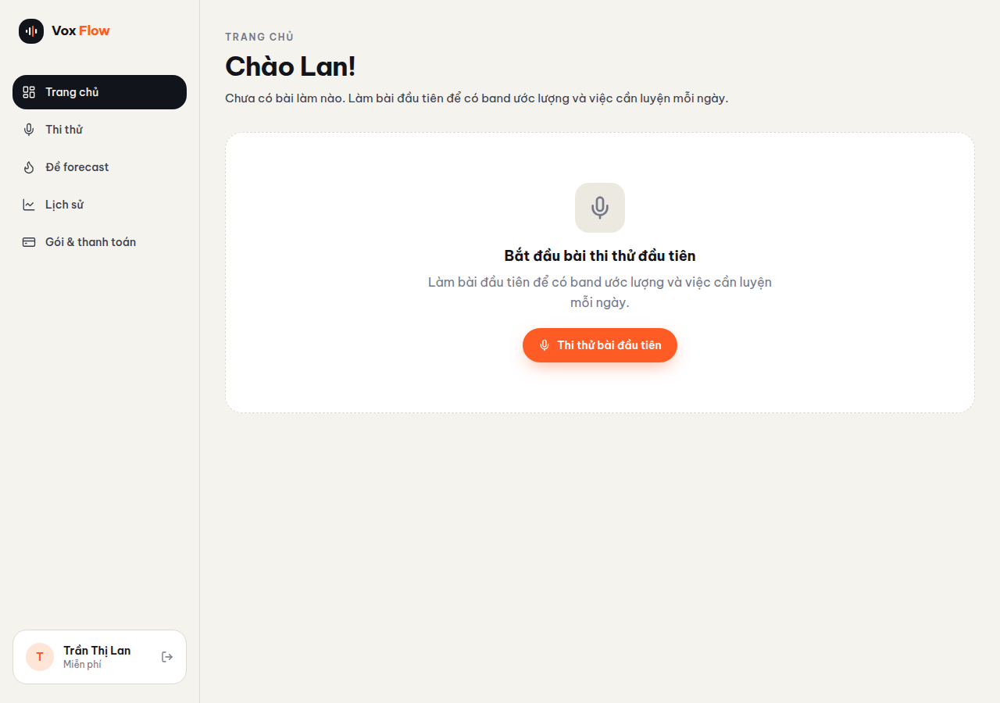
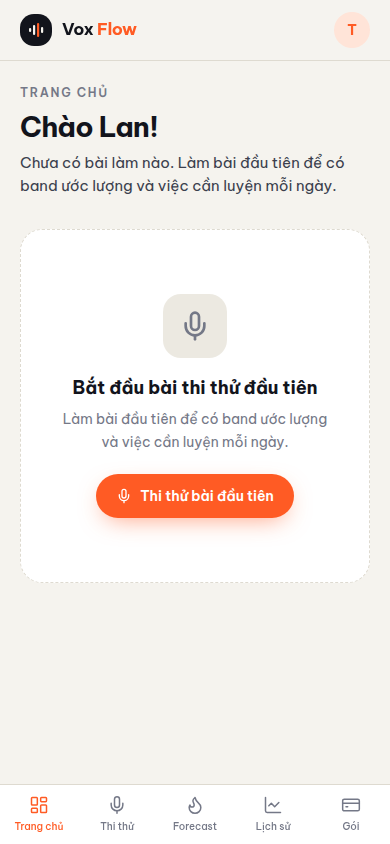
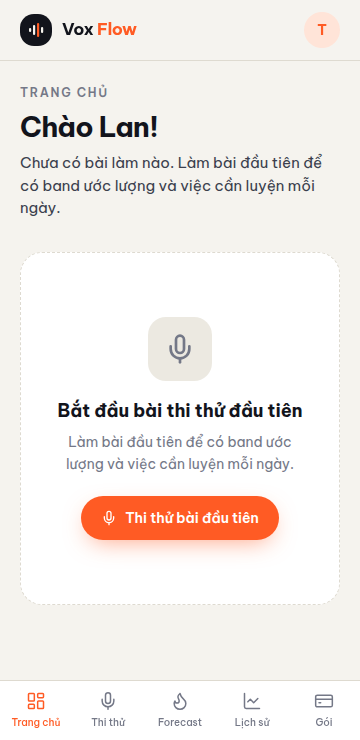
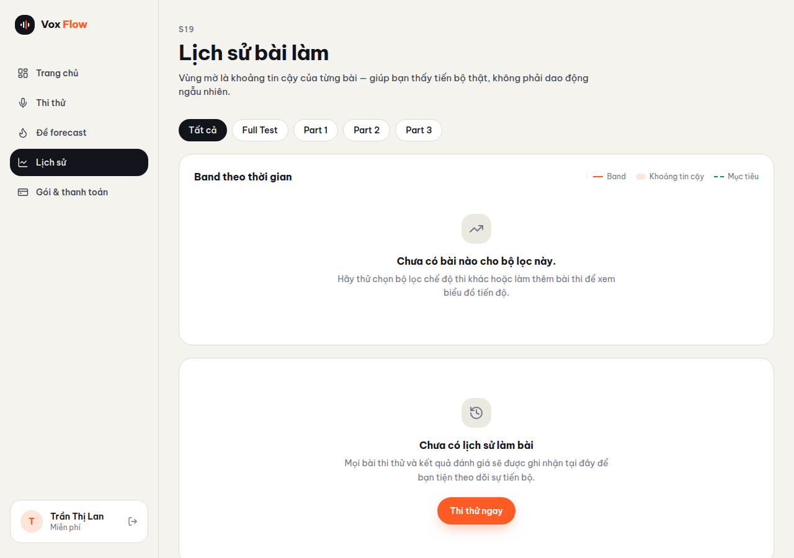
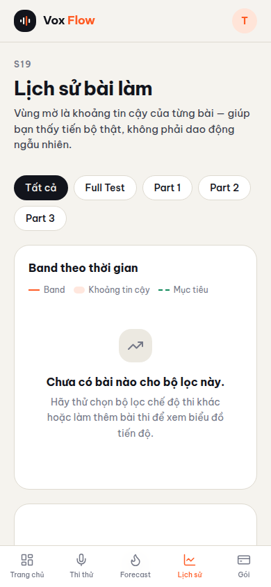
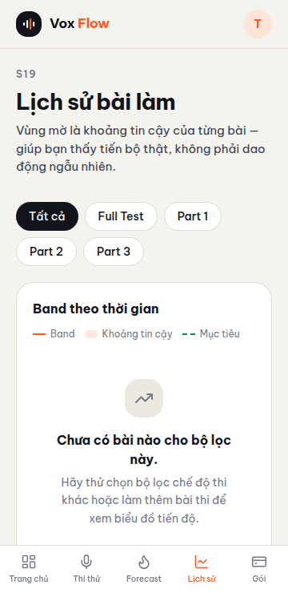

# Proof of Test (POT) — Loại bỏ mock data và xây dựng Empty State (#81)

- **Nhánh:** `vinh19410/Empty-state`
- **Commit SHA:** `b564f849ffb737fa12ec5ce91c532ea48da401b5`
- **Issue:** [#81](https://github.com/vinh19410/vox-flow/issues/81)

---

## 1. Đối chiếu Done-means

| Done-means | Trạng thái | Bằng chứng kiểm chứng |
| :--- | :---: | :--- |
| **1. Loại bỏ toàn bộ "Minh Anh" / "minhanh@" khỏi code source web** | ✅ Đạt | `rg -n "Minh Anh\|minhanh@" apps/web/src --glob '!**/*.test.*'` trả về đúng **0 dòng**. |
| **2. Component `EmptyState` chuẩn trong Design System** | ✅ Đạt | File `apps/web/src/components/ds/empty-state.tsx` hỗ trợ 3 kích thước (`sm`, `md`, `lg`), bordered, icon, primary action, secondary action. File test `empty-state.test.tsx` (5/5 tests pass). |
| **3. Trạng thái khởi tạo trung tính & sessionStorage an toàn** | ✅ Đạt | `createInitialState()` trả về `name: ""`, `email: ""`, `attempts: []`, `practiced: {}`, `saved: []`, `examDate: null`. Key lưu trữ đổi thành `vox-flow-proto-state-v2` và chỉ lưu trữ các tùy chọn UI (`mode`, `voice`, `practice`), không lưu thông tin người dùng hay lịch sử bài thi. |
| **4. Đồng bộ dữ liệu người dùng thật từ Better Auth & API** | ✅ Đạt | `useProfileHydration` nạp `name`, `email` từ `authClient.useSession()`, nạp `targetBand`, `examDate` từ `profile.get`, nạp `consent` từ `privacy.getConsent`. Reset toàn bộ dữ liệu người dùng về `createInitialState()` khi đăng xuất thật (`null`), đồng thời giữ lại tùy chọn giao diện (`mode`, `voice`); không reset khi phiên đang ở trạng thái pending (`undefined`). |
| **5. EmptyState cho các section Dashboard, Lịch sử, Forecast** | ✅ Đạt | `DashboardScreen` (empty state khi chưa có bài thi), `TodayTasks` (empty state khi chưa có bài tập cá nhân), `RecentAttemptCard` (empty state khi `attempts` rỗng), `ReadinessCard` (bỏ chip điểm giả), `CountdownCard` (bỏ chuỗi 4 ngày giả), `HistoryScreen` (empty state cho bộ lọc và lịch sử trống), `ForecastScreen` (empty state khi danh sách lưu/tìm kiếm trống). |
| **6. Beta Guard cho Chấm điểm và Thanh toán** | ✅ Đạt | Gated sau module cờ `FEATURES` (`lib/feature-flags.ts`, mặc định `false`). `ResultsScreen` hiển thị trạng thái "Tính năng chấm điểm AI sắp ra mắt", `ScoringScreen` hiển thị "Bài thi đã được ghi nhận!" mà không thêm điểm giả. `PaymentPanel` ẩn `FakeQR` và hiện "Cổng thanh toán sắp ra mắt". |
| **7. Kiểm tra cơ học bản build production không chứa mock markers** | ✅ Đạt | `pnpm --filter web check:no-mock` chạy script `scripts/check-no-mock-in-dist.mjs` quét toàn bộ dist và báo `OK: no mock markers in dist` với các marker `Minh Anh`, `minhanh@gmail.com`, `Chuỗi 4 ngày`, `Phát âm 7.0`, `Trả lời trôi chảy, có mở rộng ý`, `128 từ/phút`. |
| **8. Tests & Typecheck pass 100%** | ✅ Đạt | `pnpm check-types --force` thành công trên toàn bộ 7 packages (0 cached). `pnpm --filter web test` đạt **28/28 files, 210/210 tests pass**. `pnpm --filter @vox-flow/api test` đạt **16/16 files, 119/119 tests pass**. |

---

## 2. Bằng chứng trực quan (Screenshots)

> Chụp trên bản build production thực tế (`vite preview`), sử dụng Puppeteer (`page.setRequestInterception`) để stub phiên đăng nhập Better Auth (`/api/auth/get-session`) với user **"Trần Thị Lan"** (hiển thị initial avatar 'T' và lời chào 'Chào Lan!') và stub `profile.get` (targetBand 7.0, examDate 2026-12-15). Route `/app` cố định light theme theo thiết kế nguyên mẫu → **dark mode N/A** (precedent POT #65, #66, #71, #73, #76).
> Lưu ý: Không có ảnh chụp trực quan cho các màn hình Results, Scoring và Billing gate screens; các màn hình này được bảo đảm bằng unit/gate tests (`results-gate.test.tsx`, `billing-gate.test.tsx`).
### Dashboard — Empty State (Màn hình chính khi chưa có bài thi)

- **Viewport 1280px (Desktop):**


- **Viewport 390px (Mobile chuẩn):**


- **Viewport 360px (Mobile nhỏ):**


---

### Lịch sử thi (History) — Empty State

- **Viewport 1280px (Desktop):**


- **Viewport 390px (Mobile chuẩn):**


- **Viewport 360px (Mobile nhỏ):**


---

## 3. Log kiểm tra chất lượng (Quality Gates)

### a. `pnpm check-types --force`
```text
> turbo run check-types --force
   • Running check-types in 8 packages
@vox-flow/ui:check-types: tsc --noEmit
@vox-flow/infra:check-types: tsc --noEmit
@vox-flow/db:check-types: tsc --noEmit
@vox-flow/auth:check-types: tsc --noEmit
@vox-flow/api:check-types: tsc --noEmit
server:check-types: tsc --noEmit
web:check-types: vite build && tsc --noEmit
✓ built in 2.40s
 Tasks:    7 successful, 7 total
Cached:    0 cached, 7 total
  Time:    38.028s
```

### b. `pnpm --filter web check:no-mock`
```text
> web@0.0.0 check:no-mock
> node scripts/check-no-mock-in-dist.mjs

OK: no mock markers in dist
```

### c. `pnpm --filter web test`
```text
Test Files  28 passed (28)
     Tests  210 passed (210)
  Duration  23.20s
```

### d. `pnpm --filter @vox-flow/api test`
```text
Test Files  16 passed (16)
     Tests  119 passed (119)
  Duration  18.28s
```

---

## 4. Các quyết định tự quyết trong run

1. **Chuyển toàn bộ dữ liệu mock (`RESULT`, `REVIEW`, `SCORING_STEPS`) vào `src/test/fixtures/`**: Các file này chỉ được import trong test fixture, loại bỏ hoàn toàn khỏi production bundle.
2. **Loại bỏ việc ghi nhận điểm `band: 0` giả**: Khi hoàn thành bài thi trong giai đoạn Beta chưa có ASR/Scoring backend, hệ thống chỉ lưu câu trả lời lên server và đặt `practice: null`, không sinh ra bản ghi `band 0.0` làm sai lệch biểu đồ tiến độ.
3. **`TodayTasks` rỗng chuyển sang `EmptyState`**: Vì chưa có service gợi ý bài tập cá nhân theo lỗi sai, `TodayTasks` hiển thị trạng thái `EmptyState` hướng dẫn làm bài thi thử hoặc luyện đề forecast thay vì hiển thị danh sách 3 task cứng.

---

## 5. Các mục chưa làm trong phạm vi này (Known Scope Boundaries)

- **Regression liên quan Issue #62 (Luyện từng câu lẻ)**: Khi `FEATURES.scoring = false` trên bản Beta, `ScoringScreen` không còn ghi đè `practicedQuestions[q].count/lastPracticedAt` hay `lastPracticeSession`, và người dùng không vào được nút "Luyện câu kế tiếp" trên màn hình kết quả (màn hình kết quả hiển thị thông báo Beta "Tính năng chấm điểm AI sắp ra mắt"). Test `forecast-flow.test.tsx` đã được cập nhật để chỉ khẳng định `practice` được dọn dẹp an toàn mà không sinh attempt giả.
- **Ngân hàng câu hỏi `ITEMS` (`District 3`)**: Dữ liệu câu hỏi thi thử và transcript mẫu thuộc sở hữu của Phase 2 (G1: Ngân hàng câu hỏi thi, Issue #49).
- **Lưu lịch sử bài thi lên backend & API lịch sử (`attempt.list`)**: Thuộc sở hữu của WI18 (#22: Tiến độ band).
- **Chấm điểm ASR/LLM thật**: Thuộc sở hữu của WI13 (#17: Chấm điểm & kết quả) chờ kết quả đánh giá WI03.
- **Cổng thanh toán tự động SePay**: Thuộc sở hữu của WI15 (#19: Mua gói & QR).
